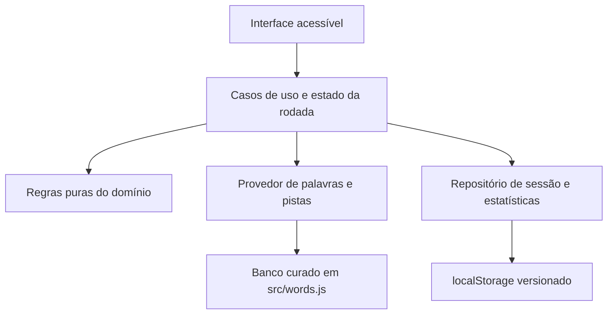
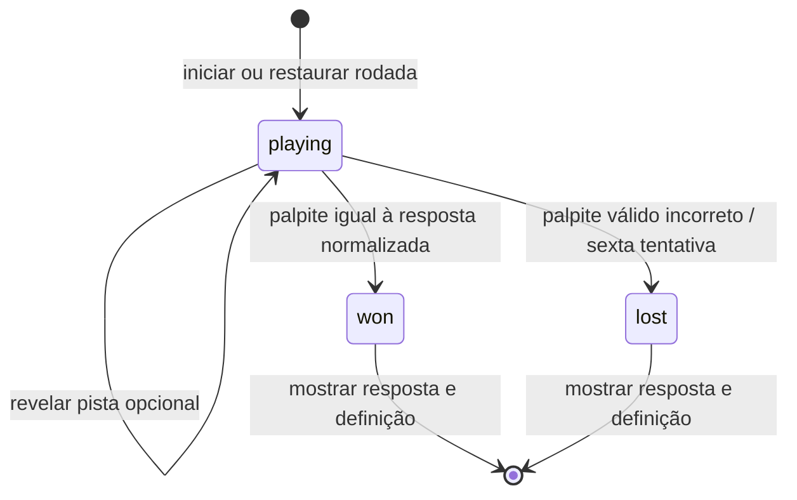

# Especificação técnica — jogo de adivinhação de palavras

**Status:** Implementação funcional do MVP; esta especificação registra o estado implementado e as limitações conhecidas  
**Base funcional e visual:** [PRD.md](./PRD.md) e protótipo aprovado [prototypes/index.html](./prototypes/index.html)  
**Implementação:** HTML, CSS e JavaScript nativos, sem dependências de pacote

## 1. Objetivo e limites

Este documento descreve a implementação do MVP definido no PRD. O PRD é a fonte de verdade para funcionalidades e comportamento do produto. O protótipo é referência visual e de interação, não uma implementação funcional nem fonte de regras conflitantes.

Não estão incluídos: contas, perfis, sincronização entre dispositivos, rankings, chat, anúncios, compras, dificuldade progressiva ou qualquer modalidade além do desafio diário e da prática livre.

O pedido mais recente inclui streak diário, em substituição à decisão anterior do PRD/SPECS de não manter sequência. O PRD foi atualizado para definir a sequência como dias consecutivos em que o desafio diário é concluído, contando vitória ou derrota. A virada diária usa UTC para manter uma palavra comum para todos na mesma data. Não há streak para partidas de prática.

## 2. Estado atual do repositório

- O jogo funcional é servido por [index.html](./index.html); o protótipo visual continua em [prototypes/index.html](./prototypes/index.html).
- A aplicação usa HTML semântico, CSS responsivo e scripts JavaScript clássicos, sem framework, etapa de build ou dependências externas.
- As regras puras e o banco curado estão em `src/game.js` e `src/words.js`; persistência e integração de interface estão em `src/persistence.js` e `src/app.js`.
- Os testes de domínio usam o runner nativo `node:test` e ficam em `tests/game.test.js`.
- O documento descreve o que foi implementado. As limitações que ainda exigem decisão estão na seção 14.

## 3. Arquitetura implementada

### 3.1 Forma da aplicação

Aplicação estática cliente, sem conta ou backend. Regras de jogo independentes da interface, armazenamento local encapsulado em um repositório e banco de palavras carregado no cliente. O projeto pode ser servido por qualquer servidor de arquivos estáticos; o README documenta execução local via Python.

O desafio diário é calculado no cliente a partir da data UTC, de uma época fixa e do banco local. Não há serviço remoto, autenticação nem analytics.

### 3.2 Camadas e responsabilidades

1. **Apresentação:** `index.html` define a estrutura acessível; `src/styles.css` implementa o layout responsivo “Caderno de pistas”.
2. **Aplicação:** `src/app.js` liga eventos, estado diário/de prática, renderização, estatísticas e compartilhamento.
3. **Domínio:** `src/game.js` implementa normalização, validação, feedback, estados, calendário UTC e estatísticas como funções testáveis.
4. **Dados e persistência:** `src/words.js` fornece as palavras e pistas; `src/persistence.js` valida, carrega e salva o estado local versionado.

Fluxo de dependência:



### 3.3 Tecnologias

| Área | Implementação |
|---|---|
| Interface | HTML semântico em `index.html`, CSS em `src/styles.css`; sem framework. |
| Linguagem | JavaScript nativo em scripts clássicos, sem transpilação ou empacotador. |
| Banco de palavras | Conteúdo curado localmente em `src/words.js`: 77 respostas e 149 palpites adicionais. |
| Persistência | `localStorage`, chave `palavra-game-v1`, formato com versão `1`. |
| Testes | `node --test` com `node:test`; sem dependências de teste. |
| Servidor local | `python -m http.server 8000`; requer Python 3, sem instalação de pacotes do projeto. |

## 4. Estrutura de pastas implementada

Estrutura presente:

```text
/
├── AGENTS.md
├── PRD.md
├── SPECS.md
├── README.md
├── docs/
│   └── plans/
│       └── 2026-10-27-jogo-casual-adivinhacao-palavras.md
├── prototypes/
│   └── index.html
├── src/
│   ├── app.js               # estado da aplicação, eventos e renderização
│   ├── game.js              # regras puras e estatísticas
│   ├── persistence.js       # repositório local versionado
│   ├── styles.css           # tokens, estilos e breakpoints
│   └── words.js             # respostas, definições, pistas e palpites aceitos
└── tests/
    └── game.test.js         # testes do domínio e do repositório
```

Os scripts são carregados na ordem definida no `<head>` de `index.html`; os objetos `WordGame`, `WordData` e `WordPersistence` são expostos ao escopo global para integração entre esses arquivos e execução dos testes Node.

## 5. Componentes e responsabilidades da interface

O jogo usa HTML semântico em vez de uma biblioteca de componentes. Os elementos e responsabilidades implementados correspondem a:

| Componente | Responsabilidade |
|---|---|
| Estrutura da página | `main.page`, cabeçalho e `section.game-shell` compõem a tela. |
| Seletor de modo | `#daily-mode` e `#practice-mode` identificam a seleção com `aria-pressed`. |
| Instruções e tentativas | `#game-title`, `#game-instructions` e `#attempt-count` mostram contexto e progresso. |
| Tabuleiro e feedback | `#board` é renderizado por `renderBoard`; cada letra preenchida recebe texto acessível, estado e símbolo não cromático. |
| Formulário | `#guess-form` e `#guess-input` permitem enviar palpites e anunciam erros no status acessível. |
| Pista | `#hint-button` alterna a região `#hint-panel`, sem penalidade. |
| Status | `#live-status` anuncia erros, feedback e encerramento por `aria-live`. |
| Estatísticas | `#stat-played`, `#stat-completed`, `#stat-streak` e `#stat-best-streak` exibem dados locais. |
| Resultado | `#round-result` apresenta vitória/derrota, resposta e definição. |
| Compartilhamento | `#share-button` usa Web Share API quando disponível, clipboard como fallback e uma área de texto selecionada se não houver alternativa automática. |

## 6. Modelo de domínio e estado da partida

### 6.1 Tipos conceituais

```text
GameMode       = "daily" | "practice"
RoundStatus    = "playing" | "won" | "lost"
LetterStatus   = "correct" | "present" | "absent"
GuessFeedback  = LetterStatus[5]

Puzzle = {
  id: string,
  answer: string,        // grafia correta
  hint: string,
  definition: string
}

RoundState = {
  mode: GameMode,
  puzzleId: string,
  dateId: string,        // YYYY-MM-DD em UTC
  guesses: [{ display: string, normalized: string, feedback: GuessFeedback }],
  status: RoundStatus,
  hintRevealed: boolean,
  countedAsPlayed: boolean,
  countedAsCompleted: boolean
}

PersonalStats = {
  played: number,
  completed: number,
  dailyStreak: number,
  bestDailyStreak: number,
  lastDailyCompletedDate: string | null
}
```

Esses campos correspondem aos objetos JavaScript serializados no repositório local. Os palpites aceitos são uma lista única criada a partir das respostas e das entradas adicionais.

### 6.2 Transições

- A sessão começa como `playing`, sem palpites e com a pista fechada.
- Enviar um palpite válido acrescenta um resultado ao tabuleiro; palpite inválido mantém estado, número de tentativas e estatísticas inalterados.
- Se a forma normalizada do palpite for igual à resposta, mudar para `won`.
- Caso contrário, depois da sexta tentativa, mudar para `lost`.
- Em `won` ou `lost`, bloquear novos palpites daquela rodada e mostrar resposta e definição.
- A pista pode ser aberta durante a rodada; não consome tentativa nem modifica o resultado do jogo.
- O modo prática permite iniciar outra rodada e evita repetir imediatamente a resposta anterior.
- O desafio diário deriva a seleção da data ISO UTC e de uma época fixa (`2026-10-27`), indexando ciclicamente as 77 respostas locais. Todos os clientes com a mesma versão do banco e código escolhem a mesma palavra na mesma data.
- Ao detectar mudança da data UTC ao alternar de modo, pedir uma pista, enviar palpite ou retornar à aba, a aplicação inicializa o novo desafio diário.



## 7. Normalização e validação de palavras

### 7.1 Normalização

`normalizeWord` em `src/game.js` é a função pura compartilhada por validação e comparação:

1. Preservar a grafia original para apresentação.
2. Normalizar a forma de comparação de maneira Unicode consistente.
3. Desconsiderar acentos e cedilha para comparação, conforme o PRD; transformar em maiúsculas com regras adequadas ao Português do Brasil.
4. Confirmar que a forma normalizada contém exatamente cinco letras permitidas. Acentos não contam como letras adicionais; pontuação, espaços, números e símbolos não são aceitos.

Usar a forma normalizada apenas para validar/comparar; a grafia de resposta em `src/words.js` é preservada para exibição no fim da rodada.

### 7.2 Validação do palpite

Separar validação sintática de validação lexical:

1. Normalizar a entrada.
2. Rejeitar entrada vazia ou que não resulte em exatamente cinco letras.
3. Consultar o conjunto curado de respostas e palpites adicionais em `src/words.js` para confirmar que é uma palavra reconhecida.
4. Se qualquer passo falhar, fornecer uma mensagem concisa e acionável; não consumir tentativa nem modificar estatísticas.
5. Se o palpite for válido, calcular feedback, registrar a tentativa e aplicar a transição de estado.

O banco atual contém 77 respostas e 149 palpites adicionais; toda resposta também é aceita como palpite. A origem é curada manualmente neste repositório, e não há dicionário externo, licença de terceiros ou atualização automática.

O conjunto de respostas deve excluir palavras impróprias/raras conforme o PRD e colisões em que palavras diferentes se tornam indistinguíveis após ignorar acentos e cedilha. A lista é limitada e não reconhece todo o vocabulário de Português.

## 8. Cálculo do feedback por letra

Usar contagem de ocorrências em duas passagens, trabalhando com letras normalizadas:

1. Inicializar as cinco posições como `absent`.
2. Primeira passagem: marcar `correct` onde palpite e resposta têm a mesma letra na mesma posição; consumir cada ocorrência exata da contagem disponível da resposta.
3. Segunda passagem, apenas nas posições ainda sem correspondência exata: se houver ocorrência não consumida dessa letra na resposta, marcar `present` e consumir uma ocorrência; senão, deixar `absent`.
4. Exibir em cada posição a letra digitada e a descrição correspondente, além do símbolo e tratamento visual.

Isso assegura que uma letra repetida no palpite não seja marcada como presente mais vezes do que ocorre na resposta. O feedback não deve comparar letras já consumidas na primeira passagem.

Pseudocódigo de domínio:

```text
calculateFeedback(answer, guess):
  remaining = count(normalize(answer))
  result = ["absent"] * 5

  for i in 0..4:
    if guess[i] == answer[i]:
      result[i] = "correct"
      remaining[guess[i]] -= 1

  for i in 0..4:
    if result[i] == "correct":
      continue
    if remaining[guess[i]] > 0:
      result[i] = "present"
      remaining[guess[i]] -= 1

  return result
```

## 9. Persistência local, estatísticas e streak

- O jogo não tem conta nem perfil. Os dados pessoais são locais ao navegador/dispositivo; não prometer sincronização entre dispositivos.
- Persistir o estado incompleto da rodada diária para permitir retomada e evitar perder tentativas ao atualizar a página.
- Persistir estatísticas pessoais para que o resumo permaneça disponível entre visitas.
- `played` aumenta uma vez na primeira tentativa válida de cada rodada, diária ou prática. Palpites inválidos não contam.
- `completed` aumenta uma vez ao encerrar uma rodada como `won` ou `lost`, diária ou prática. A flag `countedAsCompleted` impede duplicidade após restauração.
- **Streak diário:** contar dias UTC consecutivos em que uma rodada diária chega a `won` ou `lost`; o resultado da partida não altera a contagem. Prática não afeta o streak. Uma conclusão da mesma data só conta uma vez. Guardar a melhor sequência histórica e apresentar a sequência atual sem ranking ou recompensa.
- Se a última conclusão diária foi ontem (UTC), a sequência atual continua ativa até o dia de hoje ser concluído ou passar; se houver um dia UTC completo sem conclusão, a sequência atual exibida passa a zero. Ao concluir o desafio após um intervalo, iniciar uma nova sequência em 1; não apagar o recorde.
- O repositório usa `localStorage` sob a chave `palavra-game-v1`, com `version: 1`, guardando estatísticas e rodadas diária/prática. O formato incompatível ou corrompido gera aviso e a sessão continua sem persistência; falhas ao salvar também são informadas.

## 10. Responsividade e direção visual

Seguir a direção aprovada “Caderno de pistas” do [PRD](./PRD.md) e do [protótipo](./prototypes/index.html):

- Fundo em tom de papel/marfim, texto azul-noite, verde-petróleo como ação principal e amarelo-ouro para letra presente em outra posição, usando texto escuro sobre amarelo.
- Linguagem visual editorial e acolhedora, com cartões simples, contornos definidos e detalhes de pauta discretos; evitar codificação visual infantilizada.
- Ordem de leitura: modo, tentativas/instrução, tabuleiro, legenda, entrada e envio, pista opcional. O painel secundário contém explicação, estatísticas e resumo do resultado.
- Em telas largas, manter a partida como área principal e instruções/estatísticas como área de apoio.
- Em telas estreitas, reorganizar em uma coluna sem rolagem horizontal; manter tabuleiro, legenda e controles confortáveis, sem esconder o seletor de modo.
- Entrada e envio permanecem juntos; se a largura exigir, empilhar o botão abaixo do campo.
- Não depender de textura, forma ou cor para transmitir regra sem texto equivalente. Os tokens de cor do protótipo são uma referência, não um contrato de valor exato; verificar contrastes na implementação final.

## 11. Acessibilidade

Tomar os critérios descritos no PRD como requisitos de aceite:

- Operação completa por teclado, ordem de foco previsível e indicador de foco persistente.
- Rótulos explícitos para campo, modo, pista e ações; mensagens de erro e resultado anunciadas por tecnologia assistiva.
- Feedback de cada letra exposto como texto/semântica, sem depender apenas de cor ou de símbolo.
- Contraste mínimo de 4,5:1 para texto comum e 3:1 para texto grande.
- Alvos acionáveis com pelo menos 24 × 24 px CSS ou espaçamento que satisfaça a WCAG 2.2; mirar em controles maiores para toque quando possível.
- Funcionalidade e conteúdo mantidos com texto ampliado a 200%; telas estreitas sem rolagem horizontal para as áreas comuns da página.
- Sem cronômetro. Animações dispensáveis para compreender o estado, discretas e compatíveis com preferência de movimento reduzido.
- Não marcar toda a grade vazia como imagens sem nome. Fornecer ao tabuleiro um resumo acessível e expor letra e estado apenas para tentativas preenchidas.

## 12. Compartilhamento

- Compartilhamento somente do resultado diário, por ação explícita da pessoa.
- O texto/grade compartilhado não inclui a palavra resposta, dados pessoais ou identificadores de conta.
- A interface deve apresentar claramente o que será compartilhado antes da ação, se o mecanismo de compartilhamento exigir confirmação.
- A aplicação tenta Web Share API, depois clipboard, e por fim apresenta o resultado em uma área de texto selecionada para cópia manual. Cancelamento do diálogo de compartilhamento é tratado sem mostrar fallback.

## 13. Testes e validação executados

### 13.1 Testes unitários

- Normalização de maiúsculas, acentos e cedilha; preservar grafia original para exibição.
- Aceitar forma de cinco letras válida; rejeitar tamanhos incorretos, espaços, pontuação, números e entradas vazias.
- Distinguir palavra de cinco letras de palavra pertencente à lista autorizada.
- Palpite inválido não gasta tentativa nem atualiza métricas.
- As cinco posições recebem exatamente um de `correct`, `present` ou `absent`.
- Repetições e ocorrências excedentes são tratadas corretamente, incluindo resposta `LUGAR` com palpite `LLLXX`: primeiro `L` correto; `L` excedente ausente; demais resultados conforme frequência.
- Acentos ignorados na comparação, sem substituir a grafia da resposta ao revelar o resultado.
- Vitória, perda após a sexta tentativa e ausência de transição após encerramento.
- Revelar pista não consome tentativa nem altera o resultado.

### 13.2 Integração e interface

- Iniciar desafio diário e prática; modo selecionado e texto de instrução correspondem ao modo.
- Retomar uma rodada diária incompleta após recarregar e impedir novo palpite após encerramento.
- Resultado de vitória e de derrota inclui resposta e definição.
- Estatísticas atualizadas uma vez por rodada, com prática excluída do streak diário.
- Compartilhar/copy não contém resposta nem dado pessoal; testar os caminhos de fallback aprovados.
- Erros de validação visíveis e anunciados; tentativa restante inalterada.

### 13.3 Acessibilidade e responsividade verificadas

- A página carregou no navegador integrado sem erros de console; nomes, rótulos e regiões foram inspecionados na árvore de acessibilidade.
- Fluxos de interface testados no navegador: palpite inválido, pista, vitória, derrota em seis palpites, restauração, streak, prática, compartilhamento manual sem resposta e reinício de prática.
- Não houve rolagem horizontal a 320 px ou 390 px de largura; o layout de desktop foi inspecionado a 1280 px.
- O runner `node --test` concluiu 9 testes de domínio e persistência.
- Não foi feita auditoria certificada WCAG, medição automatizada de contraste, teste com leitor de tela real, zoom de 200% ou matriz de navegadores/dispositivos.

## 14. Limitações e pendências

1. **Cobertura lexical:** o banco curado é pequeno e pode não aceitar palpites válidos fora da lista. Expandir somente com conteúdo revisado, apropriado ao público e com origem/licença verificadas.
2. **Governança das palavras:** manter revisão etária, definições e pistas, palavras impróprias e colisões após normalização; hoje as listas são estáticas e não têm atualização automática.
3. **Distribuição do desafio:** a seleção determinística funciona apenas enquanto os clientes compartilham o mesmo código e banco. Publicação ou atualização centralizada não está implementada.
4. **Acessibilidade:** completar a auditoria de contraste, zoom a 200%, movimento reduzido, teclado integral e testes com tecnologias assistivas/dispositivos reais antes de declarar conformidade WCAG.
5. **Suporte de navegadores:** definir e testar a matriz mínima de navegadores e plataformas alvo.
6. **Gerenciamento de dados:** não há ação para apagar/resetar progresso; limpeza exige remover `palavra-game-v1` do armazenamento do navegador.

## 15. Execução local

Na raiz do projeto:

```powershell
python -m http.server 8000
```

Abra `http://localhost:8000`. Execute `node --test` para rodar os testes automatizados.
